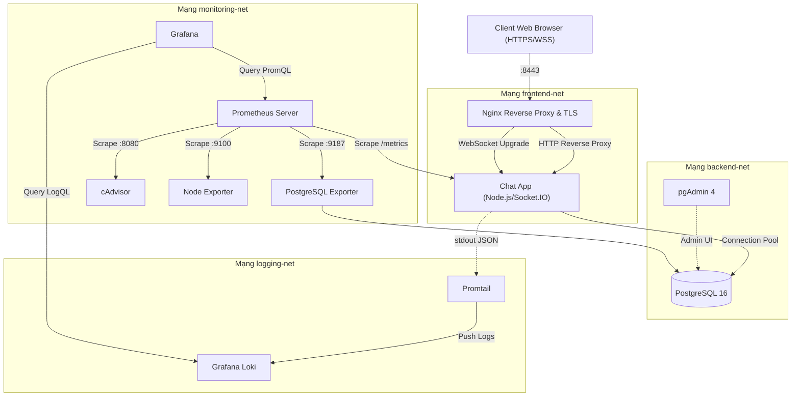

# MSSV-de32-chat-system: Hệ Thống Chat/Messaging Nội Bộ

Bài tập lớn môn học: **Triển khai và Quản trị Hệ thống Phần mềm**  
**Đề tài 32:** Hệ thống Chat/Messaging đơn giản (Internal Messaging System)

---

## 1. Giới Thiệu Đề Tài

Dự án triển khai một hệ thống Chat/Messaging nội bộ cho doanh nghiệp với khả năng trao đổi tin nhắn thời gian thực qua giao thức WebSocket, lưu trữ lịch sử tin nhắn vào PostgreSQL, định tuyến và mã hóa HTTPS thông qua Nginx Reverse Proxy, đồng thời tích hợp hệ thống quan sát đa tầng (Observability) hoàn chỉnh gồm **Prometheus + Grafana + Loki + Promtail + Exporters** bằng **Docker Compose**.

---

## 2. Công Nghệ Sử Dụng

- **Backend:** Node.js (v20+ LTS) + Express Framework.
- **Thời gian thực (Real-time):** Socket.IO (WebSocket / Polling fallback).
- **Frontend:** Vanilla HTML5, CSS3 (Glassmorphism & Dark Modern UI), JavaScript thuần (Không dùng thư viện nặng).
- **Cơ sở dữ liệu:** PostgreSQL 16 (Relational Database) + pgAdmin 4.
- **Reverse Proxy & Bảo mật TLS:** Nginx 1.25 Alpine, SSL/TLS Termination, WebSocket Upgrade.
- **Hệ thống giám sát (Monitoring):** Prometheus v2.52 + Grafana 10.4.
- **Exporters số liệu:** PostgreSQL Exporter, cAdvisor (Container metrics), Node Exporter (Host metrics).
- **Hệ thống ghi log tập trung (Logging):** Grafana Loki 3.0 + Promtail 3.0 + Winston JSON Logger.
- **Điều phối hạ tầng (Orchestration):** Docker Desktop & Docker Compose v2.

---

## 3. Sơ Đồ Kiến Trúc Hệ Thống (Architecture Diagram)



---

## 4. Cấu Trúc Thư Mục Dự Án

```text
MSSV-de32-chat-system/
├── frontend/                    # [FE] Toàn bộ mã nguồn giao diện người dùng
│   ├── index.html               # Giao diện chat chuẩn 100% theo ảnh mẫu
│   ├── login.html               # Giao diện đăng nhập & đăng ký đồng bộ
│   ├── css/
│   │   └── style.css            # Hệ thống thiết kế CSS (Dark Sidebar & Light Chat Panel)
│   ├── js/
│   │   ├── api.js               # REST API Client wrapper & JWT handler
│   │   ├── socket.js            # Socket.IO Realtime WebSocket Client
│   │   ├── chat.js              # Xử lý Channels, Users, Tin nhắn, Mentions, Emoji
│   │   └── auth.js              # Xác thực, đăng nhập nhanh (Quick Demo Login)
│   ├── assets/
│   │   └── avatars/             # Vector SVG avatars (Admin, Nguyen Van A, Tran Thi B, Doan C)
│   └── README.md                # Tài liệu chạy Frontend độc lập
├── backend/                     # [BE] Máy chủ Node.js/Express, Realtime & Database
│   ├── src/
│   │   ├── config/              # Đọc và xác thực biến môi trường
│   │   ├── db/                  # PostgreSQL connection pool và truy vấn
│   │   ├── middleware/          # JWT auth, rate limiter, validation, error handler
│   │   ├── modules/
│   │   │   ├── auth/            # Đăng ký, đăng nhập, mã hóa bcrypt
│   │   │   ├── users/           # Thông tin người dùng
│   │   │   ├── rooms/           # Quản lý kênh chat, tham gia/rời phòng
│   │   │   └── messages/        # Gửi tin nhắn, lưu DB, lấy lịch sử
│   │   ├── routes/              # REST API Router
│   │   ├── socket/              # Socket.IO Realtime Handler
│   │   ├── metrics/             # prom-client metrics endpoint (/metrics)
│   │   ├── logger/              # Winston structured JSON logging
│   │   ├── app.js               # Express application
│   │   └── server.js            # Server entrypoint
│   ├── tests/                   # Automated unit tests
│   ├── Dockerfile               # Production multi-stage build, non-root user
│   ├── .dockerignore
│   ├── package.json
│   └── README.md                # Tài liệu chạy Backend độc lập
├── database/
│   ├── migrations/              # 001_init_schema.sql (idempotent)
│   ├── seed/                    # seed sạch (demo đã loại bỏ — no-op)
│   └── README.md                # Tài liệu lược đồ & chỉ mục DB
├── nginx/
│   ├── nginx.conf               # Cấu hình Nginx gốc
│   ├── conf.d/
│   │   └── chat.conf            # Virtual host, SSL, WebSocket upgrade
│   └── certs/
│       └── README.md            # Hướng dẫn SSL tự ký
├── monitoring/
│   ├── prometheus/
│   │   ├── prometheus.yml       # Cấu hình scrape targets
│   │   └── alerts.yml           # Alert rules
│   ├── grafana/
│   │   ├── provisioning/
│   │   │   ├── datasources/     # Tự động nạp Prometheus & Loki
│   │   │   └── dashboards/      # Dashboard provider
│   │   └── dashboards/
│   │       └── chat-system-dashboard.json # Dashboard hoàn chỉnh
│   └── exporters/
│       └── README.md
├── logging/
│   ├── loki/
│   │   └── loki-config.yml      # Cấu hình Loki & retention
│   ├── promtail/
│   │   └── promtail-config.yml  # Promtail Docker discovery
│   └── logql-queries.md         # Danh sách truy vấn LogQL mẫu
├── docs/
│   ├── architecture.md          # Tài liệu kiến trúc phân tầng
│   ├── security-hardening.md    # 12 biện pháp làm cứng hệ thống
│   ├── deployment-guide.md      # Hướng dẫn chi tiết triển khai
│   ├── screenshots/
│   │   └── README.md            # Danh sách ảnh minh chứng cần chụp
│   └── report/
│       └── README.md            # Dàn ý báo cáo môn học 10+ trang
├── scripts/
│   ├── generate-certs.ps1       # Script sinh chứng chỉ SSL tự ký
│   ├── verify-config.ps1        # Script xác minh cấu hình & cổng
│   └── health-check.ps1         # Script kiểm tra sức khỏe hệ thống
├── .env.example
├── .gitignore
├── docker-compose.yml
└── README.md
```

---

## 5. Yêu Cầu Môi Trường

- **Hệ điều hành:** Windows 10/11 64-bit hoặc Linux / macOS.
- **Docker Desktop:** Docker Engine 26+ và Docker Compose v2.20+.
- **PowerShell:** PowerShell 5.1 hoặc PowerShell 7+.
- **Git for Windows:** Cung cấp OpenSSL (`C:\Program Files\Git\usr\bin\openssl.exe`).
- **RAM:** Tối thiểu 8 GB.

---

## 6. Hướng Dẫn Cấu Hình `.env`

Sao chép file mẫu `.env.example` thành file `.env`:

```powershell
Copy-Item .env.example .env
```

Các biến môi trường cấu hình cổng để **tránh xung đột với các service có sẵn trên máy**:
- `NGINX_HTTPS_PORT=8443`
- `NGINX_HTTP_PORT=8084`
- `GRAFANA_PORT=3003`
- `PROMETHEUS_PORT=9092`
- `PGADMIN_PORT=5052`
- `DB_USER=chat_user` / `DB_NAME=chat_db`
- `DB_PASSWORD`, `POSTGRES_PASSWORD`, `JWT_SECRET`, `PGADMIN_DEFAULT_PASSWORD`, `GRAFANA_ADMIN_PASSWORD`: **bắt buộc tự đặt** (mẫu trong `.env.example` ghi `CHANGE_ME`)

---

## 7. Cách Khởi Động Hệ Thống

### Bước 1: Tạo chứng chỉ SSL tự ký cho Nginx (chỉ cần chạy lần đầu)

```powershell
powershell -ExecutionPolicy Bypass -File .\scripts\generate-certs.ps1
```

### Bước 2: Kiểm tra tính hợp lệ của cấu hình

```powershell
powershell -ExecutionPolicy Bypass -File .\scripts\verify-config.ps1
```

### Bước 3: Build và khởi động các container

```powershell
docker compose up -d --build
```

---

## 8. Cách Xem Log Và Trạng Thái Container

- **Xem trạng thái tất cả các container:**
  ```powershell
  docker compose ps
  ```
- **Kiểm tra sức khỏe tự động:**
  ```powershell
  powershell -ExecutionPolicy Bypass -File .\scripts\health-check.ps1
  ```
- **Xem log ứng dụng Chat:**
  ```powershell
  docker compose logs -f chat-app
  ```
- **Xem log Nginx Reverse Proxy:**
  ```powershell
  docker compose logs -f nginx
  ```

---

## 9. Danh Sách URL Truy Cập Các Thành Phần

| Dịch vụ | URL Truy Cập | Thông tin đăng nhập | Mục đích |
|---|---|---|---|
| **Chat Application (HTTPS)** | [https://localhost:8443](https://localhost:8443) | Tài khoản Admin do bạn tạo (xem mục 10) + thành viên tự đăng ký | Giao diện chat chính thức qua Nginx |
| **Chat Application (HTTP)** | [http://localhost:8084](http://localhost:8084) | Tự động redirect sang HTTPS | Kiểm tra chuyển hướng 301 |
| **Grafana Dashboard** | [http://localhost:3003](http://localhost:3003) | `admin` / `<GRAFANA_ADMIN_PASSWORD trong .env>` | Xem biểu đồ Metrics & Logs |
| **Prometheus Web UI** | [http://localhost:9092](http://localhost:9092) | Không yêu cầu | Xem Targets & Alerts |
| **pgAdmin 4 (Quản trị DB)** | [http://localhost:5052](http://localhost:5052) | `admin@example.com` / `<PGADMIN_DEFAULT_PASSWORD trong .env>` | Quản trị PostgreSQL qua web |
| **Loki Log API** | `http://localhost:3100` | Nội bộ Docker network | Backend lưu trữ log cho Grafana |

> **Phân biệt cổng:**
> - Cổng **PostgreSQL (:5432)** và **Loki (:3100)** là cổng **NỘI BỘ**, không được công khai ra máy host để đảm bảo nguyên tắc an ninh hệ thống (Hardening).
> - Tất cả tương tác với Chat App đều đi qua Nginx cổng **`8443`** (HTTPS).

---

## 10. Tạo Tài Khoản Quản Trị (Admin) Chính Thức

Hệ thống **không còn nạp tài khoản demo** nào. Các tài khoản được tạo theo hai
cách chính thức:

- **Thành viên:** tự đăng ký qua giao diện đăng nhập (role luôn là `member`).
- **Quản trị viên (Admin):** do bạn chủ động tạo qua script khởi tạo một lần,
  mật khẩu được băm bằng **bcrypt** trước khi lưu.

### Bước 1: Điền thông tin Admin vào file `.env`

Mở file `.env`, điền 3 biến (KHÔNG đặt mật khẩu thật vào mã nguồn / git):

```env
ADMIN_USERNAME=ten_quan_tri_cua_ban
ADMIN_EMAIL=admin@noibo.local
ADMIN_PASSWORD=mat_khau_manh_cua_ban
```

### Bước 2: Khởi động lại chat-app để nạp biến mới

```powershell
docker compose up -d chat-app
```

### Bước 3: Chạy script tạo tài khoản Admin

```powershell
docker compose exec chat-app node src/scripts/create-admin.js
```

> **An toàn & idempotent:**
> - Script không bao giờ tự chạy khi khởi động container.
> - Nếu username đã tồn tại với role `admin`, script bỏ qua (không ghi đè).
> - Nếu username đã tồn tại với role khác, script từ chối (không ghi đè).
> - Mật khẩu chỉ được đọc từ biến môi trường, băm bcrypt rồi mới lưu; không in
>   ra log hay ghi vào file.

### Đổi mật khẩu Admin

Sau khi đăng nhập, mở **Hồ Sơ Tài Khoản** (biểu tượng cài đặt) và dùng mục
**Đổi Mật Khẩu** — mật khẩu cũ được xác thực bằng bcrypt trước khi cập nhật.

---

## 11. Hướng Dẫn Kiểm Tra Database

Truy cập trực tiếp PostgreSQL CLI trong container:

```powershell
docker compose exec -it postgres psql -U chat_user -d chat_db
```

Các câu lệnh kiểm tra mẫu:
```sql
\dt                     -- Xem danh sách bảng (users, rooms, room_members, messages)
SELECT id, username, role, created_at FROM users;
SELECT id, name, is_private FROM rooms;
SELECT * FROM messages ORDER BY created_at DESC LIMIT 5;
\q                     -- Thoát
```

---

## 12. Hướng Dẫn Kiểm Tra Prometheus Targets & Alerts

1. Truy cập [http://localhost:9092/targets](http://localhost:9092/targets).
2. Xác nhận 5 scrape jobs đều hiển thị **UP (màu xanh)**:
   - `prometheus` (self-scrape)
   - `chat-app`
   - `postgres-exporter`
   - `cadvisor`
   - `node-exporter`
3. Truy cập [http://localhost:9092/alerts](http://localhost:9092/alerts) để kiểm tra các luật cảnh báo đã nạp:
   - `ServiceDown`
   - `ChatAppHighErrorRate`
   - `ChatAppHighLatency`
   - `PostgresDown`
   - `PostgresHighConnections`

---

## 13. Hướng Dẫn Sử Dụng Grafana Dashboard

1. Mở trình duyệt tại [http://localhost:3003](http://localhost:3003).
2. Đăng nhập với tài khoản: `admin` / mật khẩu đã đặt trong `.env` (`GRAFANA_ADMIN_PASSWORD`).
3. Vào menu **Dashboards** -> chọn thư mục **Chat System** -> mở **Bảng Giám Sát Chat System — Đề 32**.
4. Bảng điều khiển trực quan hóa các chỉ số:
   - Số kết nối Socket.IO đang mở đồng thời.
   - Tổng số tin nhắn đã gửi.
   - Tần suất yêu cầu HTTP (Requests/sec) và phân bố mã phản hồi (2xx, 4xx, 5xx).
   - Độ trễ HTTP (Latency P50 & P95).
   - Bộ nhớ Heap của tiến trình Node.js (V8 Heap Used / Total).
   - Số lượng kết nối PostgreSQL đang hoạt động.

---

## 14. Hướng Dẫn Truy Vấn LogQL Trên Grafana Explore

1. Trên Grafana, mở menu **Explore** (biểu tượng la bàn).
2. Chọn Datasource: **Loki**.
3. Thực hiện các câu truy vấn LogQL:
   - **Xem log ứng dụng chat:**
     ```logql
     {compose_service="chat-app"}
     ```
   - **Lọc log lỗi:**
     ```logql
     {compose_service="chat-app"} |~ "(?i)error|fail"
     ```
   - **Thống kê số sự kiện đăng nhập trong 5 phút:**
     ```logql
     sum by (compose_service) (count_over_time({compose_service="chat-app"} |= "login" [5m]))
     ```

Chi tiết xem thêm tại [`logging/logql-queries.md`](logging/logql-queries.md).

---

## 15. Hướng Dẫn Kiểm Tra An Ninh Hệ Thống (Hardening Verification)

Chạy các lệnh sau để kiểm chứng các biện pháp bảo mật:
1. **Xác nhận ứng dụng không chạy quyền root:**
   ```powershell
   docker compose exec chat-app id
   # Kết quả: uid=1000(node) gid=1000(node)
   ```
2. **Xác nhận bảo vệ chống Clickjacking & MIME-sniffing:**
   ```powershell
   curl -k -I https://localhost:8443
   # Kiểm tra có X-Frame-Options: SAMEORIGIN và X-Content-Type-Options: nosniff
   ```
3. **Xác nhận mật khẩu được băm Bcrypt trong database:**
   ```powershell
   docker compose exec -T postgres psql -U chat_user -d chat_db -c "SELECT username, password_hash FROM users LIMIT 1;"
   # Giá trị bắt đầu bằng: $2a$10$...
   ```

Chi tiết 12 biện pháp an ninh xem tại [`docs/security-hardening.md`](docs/security-hardening.md).

---

## 16. Cách Dừng Hệ Thống An Toàn

- **Dừng các container (giữ nguyên dữ liệu volume):**
  ```powershell
  docker compose down
  ```
- **Dừng và xóa toàn bộ dữ liệu volume (Reset môi trường):**
  ```powershell
  docker compose down -v
  ```

---

## 17. Các Lỗi Thường Gặp & Cách Khắc Phục

1. **Lỗi xung đột cổng khi khởi động:**  
   *Nguyên nhân:* Cổng host (ví dụ `8084`, `8443`) bị ứng dụng khác chiếm.  
   *Khắc phục:* Đổi giá trị cổng tương ứng trong file `.env` sang cổng khác còn trống và chạy lại `docker compose up -d`.
2. **Trình duyệt báo lỗi kết nối SSL (Your connection is not private):**  
   *Nguyên nhân:* Đây là chứng chỉ tự ký phục vụ demo nội bộ.  
   *Khắc phục:* Nhấp "Nâng cao" (Advanced) -> Chọn "Tiếp tục truy cập localhost (không an toàn)".
3. **Nginx báo lỗi không tìm thấy `chat.crt`:**  
   *Khắc phục:* Chạy `.\scripts\generate-certs.ps1` để sinh cặp khóa SSL.

---

## 18. Danh Sách Ảnh Minh Chứng Cần Chụp

Xem danh mục chi tiết 10 ảnh minh chứng tại [`docs/screenshots/README.md`](docs/screenshots/README.md).

---

## 19. Tình Trạng Tính Năng (Implementation Status)

### Đã hoàn thành (100%):
- [x] Backend Express + Socket.IO realtime, kiến trúc modular.
- [x] Cơ sở dữ liệu PostgreSQL 16 với migration idempotent và composite index.
- [x] Giao diện người dùng thuần (Vanilla HTML/CSS/JS) hiện đại, responsive.
- [x] Nginx Reverse Proxy với HTTPS tự ký và WebSocket Upgrade.
- [x] Thu thập số liệu đa tầng bằng Prometheus và 3 Exporters.
- [x] Dashboard Grafana trực quan hóa số liệu ứng dụng, database và container.
- [x] Ghi log tập trung bằng Loki + Promtail với nhãn low-cardinality.
- [x] 12 biện pháp an ninh hệ thống và làm cứng container.
- [x] Bộ test tự động (Unit tests) đạt 100% tỷ lệ pass.
- [x] Bộ scripts PowerShell hỗ trợ vận hành và kiểm tra sức khỏe hệ thống.
- [x] Dàn ý báo cáo môn học chi tiết 10+ trang theo mẫu trường.

### Giới hạn & Đề xuất nâng cấp trong tương lai:
- [ ] Tích hợp SSL tự động Let's Encrypt qua Certbot khi đưa lên domain công khai.
- [ ] Phân cụm Socket.IO đa instance bằng Redis Pub/Sub Adapter.
- [ ] Di chuyển agent Promtail sang Grafana Alloy theo khuyến nghị dài hạn của Grafana Labs.
