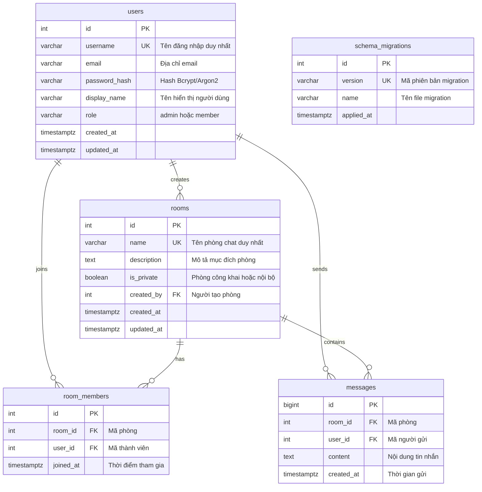

# Hướng Dẫn Cơ Sở Dữ Liệu PostgreSQL — Đề 32

Thư mục này chứa toàn bộ định nghĩa cấu trúc schema (Migrations) và dữ liệu mẫu khởi tạo (Seed) cho hệ thống Chat/Messaging.

---

## 1. Thiết Kế Lược Đồ (Schema Design)

Cơ sở dữ liệu bao gồm 5 bảng chính được thiết kế chuẩn hóa, ràng buộc toàn vẹn dữ liệu chặt chẽ:



### Ràng buộc & Tối ưu hóa chỉ mục (Indexes)
1. **`uq_users_username`**: Đảm bảo username không bị trùng lặp.
2. **`uq_room_members(room_id, user_id)`**: Đảm bảo một người dùng chỉ tham gia phòng chat một lần duy nhất.
3. **`idx_messages_room_created ON messages(room_id, created_at DESC)`**: Index composite tối ưu hoá truy vấn lấy 50 tin nhắn mới nhất của từng phòng theo thứ tự thời gian.
4. **`idx_room_members_user ON room_members(user_id)`**: Tối ưu hóa truy vấn danh sách phòng mà một người dùng đang là thành viên.

---

## 2. Quản Lý Migration & Cơ Chế Thực Thi An Toàn

- Bảng `schema_migrations` lưu lại lịch sử các file migration đã thực thi.
- Tất cả câu lệnh SQL đều sử dụng `CREATE TABLE IF NOT EXISTS`, `CREATE INDEX IF NOT EXISTS` và `ON CONFLICT DO NOTHING`, cho phép chạy lặp lại an toàn (Idempotent).

### Cách chạy Migration thủ công qua Docker Compose:

```powershell
docker compose exec -T postgres psql -U postgres -d chat_db < database/migrations/001_init_schema.sql
```

---

## 3. Dữ Liệu Khởi Tạo (Clean Init)

File `database/seed/demo_seed.sql` hiện chỉ là chú thích (no-op) — **không còn chứa dữ liệu demo**. Hệ thống khởi tạo sạch, không tạo sẵn tài khoản/phòng/room mặc định.

Tài khoản quản trị chính thức được tạo thủ công qua script an toàn `backend/src/scripts/create-admin.js` (đọc thông tin từ biến môi trường, băm mật khẩu bằng bcrypt):

```powershell
docker compose exec chat-app npm run create-admin
```

> **Lưu ý bảo mật:** Không đặt mật khẩu thật vào source code, file seed hoặc README. Mật khẩu chỉ được cung cấp qua biến môi trường cục bộ (`.env`) và luôn được băm bằng bcrypt trước khi lưu vào database. Xem hướng dẫn tạo tài khoản Admin tại `README.md` (mục 10).
