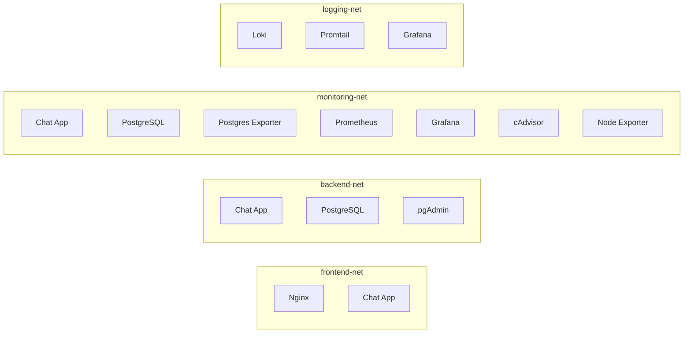

# Tài Liệu Kiến Trúc Hệ Thống (System Architecture) — Đề 32

Hệ thống Chat/Messaging nội bộ được thiết kế theo mô hình kiến trúc phân tầng (Multi-tier Architecture) với phân tách mạng nghiêm ngặt (Network Segmentation) và tích hợp sẵn hệ thống quan sát (Observability Stack) chuẩn Cloud-Native.

---

## 1. Sơ Đồ Kiến Trúc Tổng Thể

```mermaid
flowchart TD
    subgraph ClientLayer["Tầng Người Dùng (Client Layer)"]
        Browser["Trình Duyệt Web (SPA Frontend)"]
        SocketClient["Socket.IO Client (Realtime WS)"]
    end

    subgraph ProxyLayer["Tầng Cổng Vào (DMZ / Proxy Layer)"]
        Nginx["Nginx Reverse Proxy & TLS Termination\n(:80 / :443)"]
    end

    subgraph AppLayer["Tầng Ứng Dụng (Application Layer)"]
        ChatApp["Node.js / Express Chat Backend\n(:3000)\n• REST API\n• Socket.IO Server\n• Winston Logger\n• Prom-Client Metrics"]
    end

    subgraph DataLayer["Tầng Dữ Liệu (Data Layer - Isolated)"]
        Postgres[("PostgreSQL 16 Database\n(:5432 - Internal Only)")]
        PgAdmin["pgAdmin 4 (Quản trị DB)"]
    end

    subgraph ObservabilityLayer["Tầng Giám Sát & Ghi Log (Observability Layer)"]
        Prometheus["Prometheus Server (:9090)"]
        Grafana["Grafana Dashboards (:3000)"]
        Loki["Loki Log Aggregator (:3100)"]
        Promtail["Promtail Log Collector (:9080)"]
        
        PgExporter["PostgreSQL Exporter (:9187)"]
        Cadvisor["cAdvisor Container Metrics (:8080)"]
        NodeExporter["Node Exporter Host Metrics (:9100)"]
    end

    %% Client traffic
    Browser -->|HTTPS 8443| Nginx
    SocketClient -->|WSS WebSocket Upgrade| Nginx

    %% Proxy routing
    Nginx -->|HTTP Reverse Proxy| ChatApp
    Nginx -->|WebSocket Upgrade /socket.io/| ChatApp

    %% Application to Database
    ChatApp -->|Connection Pool| Postgres
    PgAdmin -.->|Admin Query| Postgres

    %% Observability Scrapes & Ingestion
    Prometheus -->|Scrape /metrics| ChatApp
    Prometheus -->|Scrape :9187| PgExporter
    Prometheus -->|Scrape :8080| Cadvisor
    Prometheus -->|Scrape :9100| NodeExporter
    PgExporter -->|Query stats| Postgres

    Promtail -->|Tail Container Logs| Loki
    Grafana -->|Query Metrics| Prometheus
    Grafana -->|Query Logs (LogQL)| Loki
```

---

## 2. Thiết Kế Mạng Cô Lập (Network Segmentation)

Hệ thống sử dụng 4 mạng Docker độc lập để đảm bảo nguyên tắc đặc quyền tối thiểu (Principle of Least Privilege):



1. **`frontend-net`**: Chỉ gồm `nginx` và `chat-app`. Ngăn chặn người dùng từ Internet truy cập trực tiếp tới database hay exporter.
2. **`backend-net`**: Kết nối giữa `chat-app`, `postgres` và `pgadmin`. Nginx hoàn toàn không thuộc network này.
3. **`monitoring-net`**: Phục vụ việc scrape metrics giữa Prometheus, Grafana và các exporters.
4. **`logging-net`**: Phục vụ việc đẩy và truy vấn log giữa Promtail, Loki và Grafana.

---

## 3. Luồng Xử Lý Dữ Liệu (Data Flows)

### A. Luồng Đăng nhập & Xác thực
1. Client gửi thông tin tài khoản qua REST `POST /api/auth/login`.
2. Nginx chuyển tiếp request tới `chat-app:3000`.
3. `auth.service.js` truy vấn database qua `db/index.js`, kiểm tra mật khẩu bằng `bcryptjs.compare`.
4. Nếu hợp lệ, hệ thống sinh JWT Token ký bằng `JWT_SECRET`, trả về JSON và thiết lập cookie `httpOnly`.

### B. Luồng Nhắn Tin Thời Gian Thực (Real-time Messaging)
1. Socket.IO Client khởi tạo kết nối WebSocket với header `Authorization: Bearer <token>`.
2. Nginx nhận request tại `/socket.io/`, thực hiện **HTTP 101 Switching Protocols** (Upgrade) và giữ kết nối mở lâu dài (`proxy_read_timeout 86400s`).
3. Socket middleware trên `chat-app` xác thực JWT trước khi cho phép kết nối.
4. Khi người dùng gửi sự kiện `chat:message`, hệ thống:
   - Ghi tin nhắn vào bảng `messages` trong PostgreSQL.
   - Tăng Prometheus counter `chat_messages_sent_total`.
   - Phát sóng (Broadcast) sự kiện tới tất cả các client đang ở trong cùng phòng chat `room_<id>`.

---

## 4. Ghi Chú Về Cách Phục Vụ Giao Diện Tĩnh (Static Serving)

Trong môi trường Docker, Nginx **không** phục vụ trực tiếp thư mục `frontend/` từ máy host. Thay vào đó:

- Nginx proxy `location /` tới `chat-app:3000` (xem `nginx/conf.d/chat.conf`).
- Backend `backend/src/app.js` phục vụ file tĩnh từ `backend/public/` (được `COPY public/ ./public/` trong `backend/Dockerfile`).
- Vì vậy, khi chỉnh sửa giao diện ở thư mục gốc `frontend/`, cần **đồng bộ sang `backend/public/`** rồi rebuild container `chat-app` (`docker compose up -d --build chat-app`) để thay đổi có hiệu lực.

Cấu trúc `backend/public/` phản chiếu đầy đủ `frontend/` (`index.html`, `login.html`, `css/`, `js/`, `assets/`).
